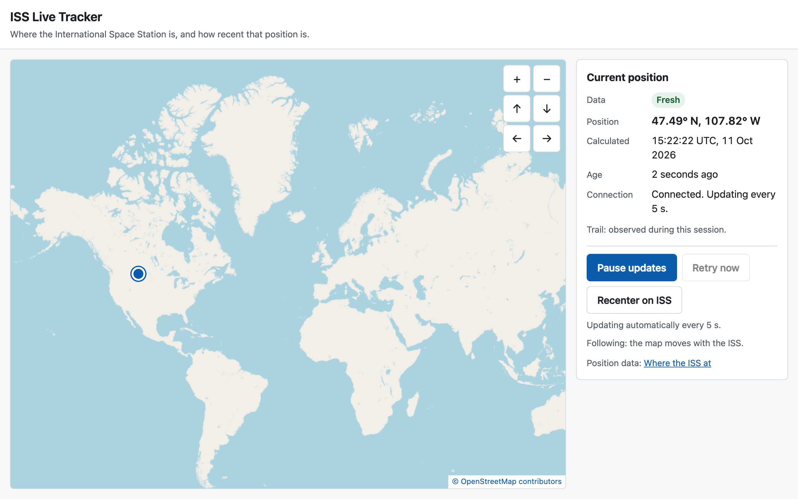

# ISS Live Tracker

[](https://github.com/alexmunzon/iss-live-tracker/actions/workflows/ci.yml)

**Where the International Space Station is right now, and an honest answer to "how old is that position?"**

**Live demo:** **[iss-live-tracker-ecru.vercel.app](https://iss-live-tracker-ecru.vercel.app)**



A small static web app (React, TypeScript, Leaflet) that polls a public ISS position API every five seconds and shows the station on a world map. The point of the project is not the map. It is doing the unglamorous parts properly: telling the truth when data is late, never hammering a free API, surviving bad responses and wrong device clocks, and proving all of that with tests.

## What's hard about this

- **Honest data age, separate from connection state.** "Connected" and "fresh" are different facts. Age starts from the provider's timestamp when a sample arrives and then advances with a monotonic clock (`performance.now()`), so changing the device clock can't make data look fresher; if wall time and monotonic time disagree by more than 5 s, the age is marked unverified. The UI can truthfully say "Offline. Last position calculated 24 seconds ago." Fresh ≤ 15 s, Delayed ≤ 60 s, Stale after that.
- **One polite poller.** A single-flight scheduler (never two requests at once, starts at least 5 s apart) backs off 10 → 20 → 40 → 60 s on failure (plus up to 20% random jitter, never above 60 s), honours a valid `Retry-After` on `429` but waits at least 60 s when the header is missing or unreadable and never more than 1 hour, stops automatic retries on client errors such as `401/403/404`, and pauses while the tab is hidden with no catch-up burst on return.
- **Wrong clocks, found from live data.** Real samples often arrived about one second "in the future" because the visitor's clock and the provider's clock disagree slightly. Without a tolerance, healthy data showed as "Delayed". The fix (2 s tolerance, decision D16) came from watching the real API, not from the spec.
- **Untrusted input, handled like it.** Every response is validated without coercion (no `"45"` becoming `45`), bodies are capped at 64 KiB with a bounded stream reader, the 8 s timeout covers reading the body, redirects are rejected, and remote text is never rendered as HTML. Late results from aborted or superseded requests are discarded by a generation counter, so they can never roll the display back.
- **Strict Content-Security-Policy with no `unsafe-inline`.** The production build loads no inline scripts or styles; the E2E tests run against the same headers the host serves, and a unit test fails if the host config drifts from them.
- **Accessible by default.** Keyboard and button alternatives to dragging the map, visible focus, 44 px targets, a screen-reader live region that announces state changes but not every tick, and automated WCAG 2.2 AA checks with axe.

## Proof it works

| Layer              | What runs                                                                                                                                                                          | Where                                        |
| ------------------ | ---------------------------------------------------------------------------------------------------------------------------------------------------------------------------------- | -------------------------------------------- |
| Unit + integration | 18 files / 497 tests (Vitest, fake clocks): validation, freshness, scheduler, map lifecycle, App flows                                                                             | `tests/unit`, `tests/integration`            |
| Browser E2E        | Production build with real security headers, in **Chromium, Firefox and WebKit** (123/123): first sample, outage, stale, recovery, dateline crossing, layouts, axe, CSP, injection | `tests/e2e`                                  |
| CI                 | Every push and pull request runs all of the above. No secrets; the ISS API and map tiles are intercepted, so CI never sends traffic to real providers                              | `.github/workflows/ci.yml`                   |
| Evidence           | Each acceptance criterion (A01–A20) mapped to its tests, with what is still manual                                                                                                 | [`docs/qa-evidence.md`](docs/qa-evidence.md) |

Bundle: about 123 kB gzipped JavaScript (budget 250 kB). Runtime dependencies: React, React DOM and Leaflet only.

## How it was built

I built this as a product owner directing AI coding agents ([Claude Code](https://claude.com/claude-code)), using a coordinator-and-workers process instead of one long chat:

1. **Plan and contracts first.** A written scope, threat model and numbered acceptance ledger ([`docs/phase0-plan.md`](docs/phase0-plan.md)), then frozen interface contracts ([`docs/contracts.md`](docs/contracts.md)) before any feature code.
2. **Parallel workers with file ownership.** Separate data, UI and QA agents worked in isolated git worktrees on files only they owned. QA wrote its tests from the contract, not from the implementation.
3. **Review gates.** A coordinator integrated each branch only after its checks passed, and an independent security review ran before release. Every decision and its reason is logged in [`docs/decisions.md`](docs/decisions.md).

The commit history shows those stages (`G1` contracts → `DATA-1`, `UI-1`, `QA-1` → `G2` integration).

## Engineering details

Status labels this project uses: **Implemented** (gates incomplete) → **Locally verified** → **Deployment ready** → **Deployed and verified**. Current status: **Deployed and verified** on Vercel. The verified production commit, test results and the manual checks still NOT RUN (such as a real screen-reader listening pass) are in one place: [current status](docs/agent-state.md#current-status). Every merge to `main` redeploys automatically.

### Setup

Requires Node ≥ 22.12 (developed on Node 24.16, npm 11.13).

```bash
npm ci          # installs exactly the lockfile; install scripts are disabled by .npmrc
npm run dev     # http://localhost:5173
```

### Commands

| Command                    | What it checks                                                                                                                                                            |
| -------------------------- | ------------------------------------------------------------------------------------------------------------------------------------------------------------------------- |
| `npm run format:check`     | Prettier formatting                                                                                                                                                       |
| `npm run lint`             | ESLint, banning HTML-injection sinks (innerHTML/outerHTML writes, dangerouslySetInnerHTML, insertAdjacentHTML, Leaflet popup/tooltip/divIcon HTML), eval and new Function |
| `npm run typecheck`        | Strict TypeScript                                                                                                                                                         |
| `npm run test:unit`        | Domain, data, UI and hook unit tests (Vitest, jsdom)                                                                                                                      |
| `npm run test:integration` | Cross-module and App tests with fake clocks                                                                                                                               |
| `npm run build`            | Typecheck + production build to `dist/`                                                                                                                                   |
| `npm run test:e2e`         | Playwright against `vite preview` (needs `npx playwright install` once)                                                                                                   |
| `npm run check`            | Everything above except E2E                                                                                                                                               |

CI runs `npm run check` and the E2E suite in all three browsers on every push and pull request. CI, unit and E2E tests never call the real ISS API or OpenStreetMap; both are intercepted.

### How it works

```
pollingMachine (one timer, one request) → issClient (fixed URL, 8 s timeout, 64 KiB cap)
  → validatePosition → freshness/ordering → snapshot → useTracker → App → IssMap + StatusPanel
```

- `src/domain/position.ts`: shared types. `src/config/trackerPolicy.ts`: every timing and threshold.
- The map never fetches data or owns timers. The network code never moves the map.
- Contracts: `docs/contracts.md`. Decisions: `docs/decisions.md`.

### What the data means

- Positions come from [Where the ISS at](https://wheretheiss.at/), which calculates them from published orbital elements. They are **estimates, not onboard telemetry**, and carry no accuracy guarantee. Two-decimal coordinates are display precision only.
- **Fresh** ≤ 15 s old, **Delayed** ≤ 60 s, **Stale** > 60 s, measured from the provider's calculation time. These are product rules, not accuracy claims.
- Connection state is shown separately from data age. When the source fails, the last real position stays visible with its true age. The app never invents, predicts or swaps in another provider's coordinates.
- The trail shows only positions received while the page has been open (≤ 120 points, ≤ 10 minutes). It splits at the antimeridian and after gaps.

### Privacy

Your browser requests positions from `api.wheretheiss.at` and map images from `tile.openstreetmap.org`. Both receive your IP address and browser details; the hosting provider will log requests too. The site sets no cookies, has no analytics or accounts, never asks for your location, and stores nothing. The trail lives in memory and is gone when you close the page.

### Credits and licenses

- Map data © [OpenStreetMap contributors](https://www.openstreetmap.org/copyright), tiles used under the [OSM tile usage policy](https://operations.osmfoundation.org/policies/tiles/): attribution always visible, browser caching, no prefetching. Heavy public traffic may need a different tile provider (backlog P1).
- Position data: [Where the ISS at](https://wheretheiss.at/) (no API key; about 1 request per second per client allowed).
- Shipped libraries: React and React DOM (MIT, © Meta Platforms, Inc.), scheduler (MIT), Leaflet 1.9.4 (BSD-2-Clause, © 2010-2023 Volodymyr Agafonkin, © 2010-2011 CloudMade). The bundler strips license comments, so full texts ship as `/NOTICES.txt` (from `public/NOTICES.txt`). Regenerate it whenever a runtime dependency changes.

### Known limitations

- A visitor whose device clock runs more than 30 s slow sees a "device clock looks wrong" message instead of a position (D15).
- Browsers can't read the provider's rate-limit or `Retry-After` headers (not exposed via CORS), so a rate limit is handled as "wait at least 60 s".
- About 6 open tabs sharing one network IP would exceed the provider's limit of 350 requests per 5 minutes.
- OpenStreetMap's public tiles have no SLA and can be blocked without notice. When tiles fail, the text panel keeps working.

### Deployment

Hosted on Vercel, linked to this repository: every push to `main` builds and deploys with `vercel.json`. To host elsewhere:

1. Pick a static host that supports **custom response headers** (D11).
2. `npm ci && npm run check && npm run test:e2e`, then upload `dist/`.
3. Configure these response headers on every response. On Vercel, `vercel.json` already does this; it mirrors `securityHeaders` in `vite.config.ts`, and `tests/unit/config/hostHeaders.test.ts` fails if they diverge:
   - `Content-Security-Policy: default-src 'none'; script-src 'self'; style-src 'self'; img-src 'self' data: https://tile.openstreetmap.org; connect-src https://api.wheretheiss.at; font-src 'self'; manifest-src 'self'; object-src 'none'; base-uri 'none'; form-action 'none'; frame-ancestors 'none'`
   - `X-Content-Type-Options: nosniff`
   - `Referrer-Policy: strict-origin-when-cross-origin`
   - `Permissions-Policy: geolocation=(), camera=(), microphone=()`
   - `Cross-Origin-Opener-Policy: same-origin`
   - `Strict-Transport-Security: max-age=63072000; includeSubDomains` (HTTPS only)
4. Cache `assets/*` (content-hashed) for a long time; serve `index.html` with `Cache-Control: no-cache` so a new release is picked up.
5. After deploying, verify on the real URL: HTTPS, the headers above, no CSP errors in the console, the marker moving, attribution visible, and the outage and stale states.

### Rollback

Redeploy the previous known-good `dist/` (or the host's previous deployment) with the same headers. If the provider is down, leave the app up: it shows an honest stale state. Don't switch providers in a hurry.
